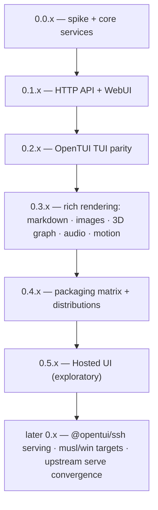

# Roadmap

Versioning policy: **0.x.y indefinitely** — minor = milestone, patch = fixes. Breaking changes allowed at any minor; no 1.0 is implied.

## Milestones

| Version | Scope | Status |
|---|---|---|
| 0.0.x | Feasibility spike ✓ · core services over the `skills` subprocess contract ✓ · HTTP API + WebUI port ✓ · OpenTUI TUI with the full keyboard contract ✓ · packaging matrix ✓ · audio synth + markdown + image pipeline ✓ | done (this milestone) |
| 0.1.x | HTTP API (10 endpoints + `/api/version`) via `Bun.serve`; WebUI port; `--web` / `serve` modes | done — absorbed into 0.0.x (S-61/S-62, 2026-10-28) |
| 0.2.x | Parity where it matters (map S-65): list ops (`I`/`A`/`s`, settings → `,`, PgUp/PgDn), single remove `r` + update-all `u`, update-check wiring (`c`/`↑`/hint), agent filter `a` (multi-select + all) + description match, search-queue sub-view (Tab), crash-guard + adjustedQuery notice, `skills`-version display | **done** — S-69–S-75 shipped, 50 tests green, binary `skills-ui-0.2.0-darwin-arm64` (2026-10-28) |
| 0.3.x | Rich rendering depth: images in real views (splash, source cards), 3D graph view (`@opentui/three`), motion polish, mouse interactions (wheel-scroll the hovered pane, click to select/focus — OpenTUI built-ins, S-88 evidence: reporting already on, wheel not yet wired). Markdown detail, audio synth, image pipeline and theme tokens already landed in 0.0.x | done — S-89, S-100–S-103 (rich views, search depth); no separate tag, released within v0.4.0 |
| 0.4.x | Packaging matrix: darwin-arm64 → linux-x64/arm64 → win32; `OPENTUI_LIBC`, codesign, version stamping | done — v0.4.0 tagged + published, repo public (2026-10-29) |
| 0.5.x | Hosted UI (below) | ratified go (S-129, 2026-10-29) — build is follow-on |

## Hosted UI (0.5.x, exploratory)

Ratified 2026-10-29 (verdict ticket [S-129](https://linear.app/s-a-c/issue/S-129/05x-verdict-ratify-gono-go-per-line-and-update-roadmap-folds-in); evidence in the [0.5.x map](https://linear.app/s-a-c/issue/S-120/skills-ui-05x-route-wayfinder-map-wasm-app-exploratory)). The line is a **hosted zero-install WebUI** — a static page (hosting choice is follow-on) talking to the user's local `skills-ui serve` for all mutations. Audience: public demo primary, other skills users secondary; `--web` remains the private/local path.

1. **Hosted zero-install WebUI — GO.** Chrome 142+/Edge and Firefox 153+ reach `serve` via the Local Network Access permission prompt; Safari blocks loopback outright (WebKit 171934). Serve owes plain CORS (OPTIONS preflight + ACAO with `Vary: Origin`), a Bearer token in `Authorization` (RFC 6750 — never query-string), and a Host-header allowlist (127.0.0.1/localhost/[::1]) against DNS rebinding; skills.sh search proxies through serve (it sends no ACAO); the page owns the LNA prompt/denial UX.
2. **Browser-bundled core — feasible, and no wasm exists.** The portable core subset is plain TS (7.5 KiB min / 3.4 KiB gzip, probed). Whether to bundle it into a page at all is a follow-on design choice.
3. **TUI-in-browser — no-go for shipping.** Upstream has no browser path (FFI natives; roadmap #821 has zero web targets); an optional PoC spike (opentui-web fork) is follow-on fun, not product.

Guardrails (what this line never grows into):

- `serve` stays loopback-bound, single-user — never remote/multi-user serving of one endpoint.
- No hosted registry/search backend — skills.sh proxied through serve at most.
- No TUI parity in the browser — browser gets the WebUI only; the TUI stays native.
- The static bundle never enters the native-app packaging gates.

The build itself (hosting/distribution, serve-side CORS/token, capabilities negotiation, optional PoC spike) is a follow-on effort.

## Later (unversioned)

- `@opentui/ssh` — serve the TUI over SSH.
- musl + Windows targets in the packaging matrix.
- Convergence: if `vercel-labs/skills` ever ships a headless `skills serve`, swap the subprocess backend for it without architecture change.
