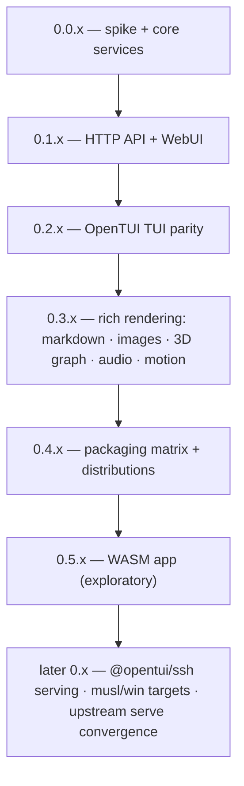

# Roadmap

Versioning policy: **0.x.y indefinitely** — minor = milestone, patch = fixes. Breaking changes allowed at any minor; no 1.0 is implied.

## Milestones

| Version | Scope | Status |
|---|---|---|
| 0.0.x | Feasibility spike ✓ · core services over the `skills` subprocess contract ✓ · HTTP API + WebUI port ✓ · OpenTUI TUI with the full keyboard contract ✓ · packaging matrix ✓ · audio synth + markdown + image pipeline ✓ | done (this milestone) |
| 0.1.x | HTTP API (10 endpoints + `/api/version`) via `Bun.serve`; WebUI port; `--web` / `serve` modes | done — absorbed into 0.0.x (S-61/S-62, 2026-10-28) |
| 0.2.x | Parity where it matters (map S-65): list ops (`I`/`A`/`s`, settings → `,`, PgUp/PgDn), single remove `r` + update-all `u`, update-check wiring (`c`/`↑`/hint), agent filter `f` + description match, search-queue sub-view (Tab), crash-guard + adjustedQuery notice, `skills`-version display | sliced — 7 build issues S-69–S-75 (2026-10-28) |
| 0.3.x | Rich rendering depth: images in real views (splash, source cards), 3D graph view (`@opentui/three`), motion polish. Markdown detail, audio synth, image pipeline and theme tokens already landed in 0.0.x | planned |
| 0.4.x | Packaging matrix: darwin-arm64 → linux-x64/arm64 → win32; `OPENTUI_LIBC`, codesign, version stamping | planned |
| 0.5.x | WASM app (below) | exploratory |

## WASM app (0.5.x, exploratory)

A browser-native build of the WebUI — static assets, zero install — talking to a `skills-ui serve` endpoint for mutations. Open questions to resolve during 0.4.x:

1. **Build path** for the shared core compiled to wasm (Bun browser target vs emscripten).
2. **Connectivity** — subprocess is unavailable in wasm; the headless local API (or a bridge) is the only route to `skills`.
3. **OpenTUI in the browser** — whether its renderers can target canvas/wasm; if not, WASM ships the WebUI only.

## Later (unversioned)

- `@opentui/ssh` — serve the TUI over SSH.
- musl + Windows targets in the packaging matrix.
- Convergence: if `vercel-labs/skills` ever ships a headless `skills serve`, swap the subprocess backend for it without architecture change.
