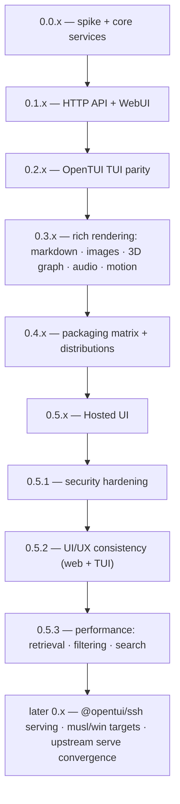

# Roadmap

Versioning policy: **0.x.y indefinitely** — minor = milestone, patch = fixes. Breaking changes allowed at any minor; no 1.0 is implied.

## Milestones

| Version | Scope | Status |
|---|---|---|
| 0.0.x | Feasibility spike ✓ · core services over the `skills` subprocess contract ✓ · HTTP API + WebUI port ✓ · OpenTUI TUI with the full keyboard contract ✓ · packaging matrix ✓ · audio synth + markdown + image pipeline ✓ | done (this milestone) |
| 0.1.x | HTTP API (10 endpoints + `/api/version`) via `Bun.serve`; WebUI port; `--web` / `serve` modes | done — absorbed into 0.0.x (S-61/S-62, 2026-10-28) |
| 0.2.x | Parity where it matters (map S-65): list ops (`I`/`A`/`s`, settings → `,`, PgUp/PgDn), single remove `r` + update-all `u`, update-check wiring (`c`/`↑`/hint), agent filter `a` (multi-select + all) + description match, search-queue sub-view (Tab), crash-guard + adjustedQuery notice, `skills`-version display | **done** — S-69–S-75 shipped, 50 tests green, binary `skills-ui-0.2.0-darwin-arm64` (2026-10-28) |
| 0.3.x | Rich rendering depth: images in real views (splash, source cards), 3D graph view (`@opentui/three`), motion polish, mouse interactions (wheel-scroll the hovered pane, click to select/focus — OpenTUI built-ins, S-88 evidence: reporting already on, wheel not yet wired). Markdown detail, audio synth, image pipeline and theme tokens already landed in 0.0.x | done — S-89, S-100–S-103 (rich views, search depth); no separate tag, released within v0.4.0 |
| 0.4.x | Packaging matrix: darwin-arm64 → linux-x64/arm64 → win32; `OPENTUI_LIBC`, codesign, version stamping | done — v0.4.0 tagged + published, repo public (2026-10-29) |
| 0.5.x | Hosted UI (below) | **done** — map S-130 shipped 2026-10-30: page live on Pages, serve gate, e2e 3/3, GATES-0.5.x 6/7 (G7 = the manual LNA prompt click) |
| 0.5.1 | Security hardening: comprehensive audit + fixes across serve API, hosted page + installer + release pipeline, dependencies/supply chain (map [S-142](https://linear.app/s-a-c/issue/S-142/skills-ui-051-security-hardening-wayfinder-map)) | **done** — S-156–S-159 shipped, `v0.5.1` tagged (signed) + released 2026-10-30, all 9 should-fixes + rate limiting; GATES-0.5.1 7/8 (G7 = the manual live smoke) |
| 0.5.2 | UI/UX consistency across web (local `--web` + hosted) and TUI: audits → divergence matrix → ratified fix slice (map [S-143](https://linear.app/s-a-c/issue/S-143/skills-ui-052-uiux-consistency-wayfinder-map-web-tui)) | next |
| 0.5.3 | Performance of retrieval, filtering, search: baselines → ratified budgets + harness → fixes for the ratified hot paths (map [S-144](https://linear.app/s-a-c/issue/S-144/skills-ui-053-performance-wayfinder-map-retrieval-filtering)) | later |

## Hosted UI (0.5.x, shipped)

**Shipped 2026-10-30 (build map [S-130](https://linear.app/s-a-c/issue/S-130/skills-ui-hosted-ui-build-wayfinder-map-05x-github-pages)): live at <https://s-a-c.github.io/skills-ui/app.html>** — connect dialog (backend URL + Hosted-UI token), LNA prompt/denial UX, capabilities negotiation; serve hardened per the verdict. Playwright e2e from the real hosted origin (grant/negative/wrong-token) green; `GATES-0.5.x.md` 6/7 met — G7 is the one human step, the native LNA prompt click on first connect.

Ratified 2026-10-29 (verdict ticket [S-129](https://linear.app/s-a-c/issue/S-129/05x-verdict-ratify-gono-go-per-line-and-update-roadmap-folds-in); evidence in the [0.5.x map](https://linear.app/s-a-c/issue/S-120/skills-ui-05x-route-wayfinder-map-wasm-app-exploratory)). The line is a **hosted zero-install WebUI** — a static page (hosting choice is follow-on) talking to the user's local `skills-ui serve` for all mutations. Audience: public demo primary, other skills users secondary; `--web` remains the private/local path.

1. **Hosted zero-install WebUI — GO.** Chrome 142+/Edge and Firefox 153+ reach `serve` via the Local Network Access permission prompt; Safari blocks loopback outright (WebKit 171934). Serve owes plain CORS (OPTIONS preflight + ACAO with `Vary: Origin`), a Bearer token in `Authorization` (RFC 6750 — never query-string), and a Host-header allowlist (127.0.0.1/localhost/[::1]) against DNS rebinding; skills.sh search proxies through serve (it sends no ACAO); the page owns the LNA prompt/denial UX.
2. **Browser-bundled core — feasible, and no wasm exists.** The portable core subset is plain TS (7.5 KiB min / 3.4 KiB gzip, probed). Whether to bundle it into a page at all is a follow-on design choice.
3. **TUI-in-browser — no-go for shipping.** Upstream has no browser path (FFI natives; roadmap #821 has zero web targets); an optional PoC spike (opentui-web fork) is follow-on fun, not product.

Guardrails (what this line never grows into):

- `serve` stays loopback-bound, single-user — never remote/multi-user serving of one endpoint.
- No hosted registry/search backend — skills.sh proxied through serve at most.
- No TUI parity in the browser — browser gets the WebUI only; the TUI stays native.
- The static bundle never enters the native-app packaging gates.

Shipped follow-ons not taken here (parked): browser-bundled core (feasible, no wasm — a later design choice) and the optional TUI-in-browser PoC spike.

## Hardening series (0.5.1–0.5.3, charted 2026-10-30)

Three follow-on wayfinder maps inside the 0.5.x line, each **defog-first** (read-only audits) and closing on its own **shipped patch release** — execution carried into the map, not handed off. Serial order ratified: security → UI/UX → performance (audit defog may run early in parallel; implementation waits for the prior map's ship gate).

Ship gate per milestone: merged to `main`, `bun test` green, tagged release with binaries built, hosted page updated when web-facing, gate ledger (`GATES-0.5.1/2/3.md`) with evidence, live checks pass.

| Map | Scope | Skills (beyond the mandatory set: wayfinder · grill-with-docs · unlazy · code-review-and-quality · i-have-adhd · caveman) |
|---|---|---|
| [S-142](https://linear.app/s-a-c/issue/S-142/skills-ui-051-security-hardening-wayfinder-map) | serve API · hosted page · installer/pipeline · deps/supply chain | security-and-hardening · github:secret |
| [S-143](https://linear.app/s-a-c/issue/S-143/skills-ui-052-uiux-consistency-wayfinder-map-web-tui) | consistency definition → divergence matrix → ratified slice | frontend-design · web-design-guidelines · tui-design · opentui |
| [S-144](https://linear.app/s-a-c/issue/S-144/skills-ui-053-performance-wayfinder-map-retrieval-filtering) | retrieval pipeline · filtering/search paths · budgets + harness | performance-optimization · systematic-debugging |

## Later (unversioned)

- `@opentui/ssh` — serve the TUI over SSH.
- musl + Windows targets in the packaging matrix.
- Package-manager distribution (Homebrew tap, winget, scoop, …) — the `curl | sh` installer (`scripts/install.sh`, checksum-verified) covers the interim.
- Convergence: if `vercel-labs/skills` ever ships a headless `skills serve`, swap the subprocess backend for it without architecture change.
